# PRM323 — LAB 2: THIẾT KẾ UI/UX CÓ HỖ TRỢ AI (CARESITTER)

> **Môn học:** PRM323 — Lập trình ứng dụng di động  
> **Bài tập:** Lab 2 — Thiết kế UI/UX có hỗ trợ AI (Google Stitch → Figma → Flutter Handoff)  
> **Dự án:** CareSitter — Nền tảng đồng hành và chăm sóc người cao tuổi phi y tế tại nhà  
> **Repository:** [LAB2_PRM](https://github.com/ThwnThwn/LAB2_PRM)  
> **Trạng thái:** Đầy đủ hồ sơ nộp bài, 12 slide thuyết trình, prototype Figma 6 page và bằng chứng chat rà soát.

---

## 1. Hệ thống liên kết chính thức & Bằng chứng minh chứng (Official Links & Evidence)

| Hạng mục | Liên kết chính thức | Mục đích & Nội dung minh chứng |
| :--- | :--- | :--- |
| **Cuộc trò chuyện minh chứng (Chat Evidence)** | [ChatGPT Rà soát & Phản biện Lab 2](https://chatgpt.com/s/cx_6ad371cf90308191ab53a511a2212c74) | Minh chứng toàn bộ quá trình đối thoại AI, trích xuất đề bài, phản biện Persona và hoàn thiện hồ sơ |
| **Figma Design chính thức (6 Page)** | [Figma LAB02_CareSystem](https://www.figma.com/design/Ph22SZvtVFwWzohuaia1UC/LAB02_CareSystem?node-id=0-1&t=y8TBlIsxnOdSbWSD-1) | Đầy đủ 6 trang theo rubric: `01 User Flow`, `02 Wireframe`, `03 Final UI`, `04 Design System`, `05 Components`, `06 Prototype` |
| **Figma Make (Image Retrieval Source)** | [Figma Make — Mobile app image retrieval](https://www.figma.com/make/zYbuvraAFDQoVb6wEXhpnH/Mobile-app-image-retrieval?t=HrAK44qDKK2rzSvZ-1) | Kho asset gốc, bóc tách frame và minh họa giao diện |
| **Canva Slide Presentation (12 Slides)** | [Canva 12 Slides Trình bày Lab 2](https://canva.link/55qt0sv9dsz7w3g) | Bộ 12 slide thuyết trình bảo vệ 10 phút trước hội đồng |
| **Tài liệu Google Docs tổng hợp** | [Google Docs — Hồ sơ rà soát](https://docs.google.com/document/d/1fBMiqKdpAtMjy8XKDpX7-WQMsufw5_SPwp1s8oMFH_8/edit?usp=sharing) | Bản tổng hợp Persona, rà soát đối chiếu và checklist |
| **Google Stitch Project** | [Stitch LAB2 - CareSitter](https://stitch.withgoogle.com/projects/16914427060621528532) | Dự án thiết kế UI nguồn trên Google Stitch |
| **Mã nguồn dự án CareSitter** | [GitHub CareSitter](https://github.com/ThwnThwn/CareSitter) | Toàn bộ mã nguồn backend, frontend Flutter Customer App và tài liệu kiến trúc |

---

## 2. Tài liệu đính kèm trong Repository

- **[Báo cáo Persona & Brainstorming chuẩn 100/100](PERSONA_GUIDELINE_REPORT.md)**: Tuân thủ đầy đủ hướng dẫn [PRM393 Persona Guideline](https://prm393-material.web.app/persona-guideline), gồm 4 Persona (12 trường cốt lõi + 4 trường bắt buộc của Lab 2), phân loại bằng chứng Observed/Reported/Inferred/Assumed, Stakeholder Map, Affinity Board, và ma trận ánh xạ sang quyết định UI.
- **[Tài liệu Kỹ thuật Flutter Handoff](FLUTTER_HANDOFF_SPEC.md)**: Bảng quy đổi Design System (Tokens màu, typography, spacing 8px) sang Flutter Widgets, cùng đặc tả kỹ thuật 6 mục cho 8 màn hình mobile trọng tâm.

---

## 3. Cấu trúc 12 Slide thuyết trình & Ảnh xem trước cục bộ

| Slide | Tiêu đề | Nội dung trọng tâm | Xem trước |
| :---: | :--- | :--- | :---: |
| **01** | **Project Overview** | Giới thiệu dự án CareSitter, đối tượng phục vụ, thành viên và link repo/Figma | 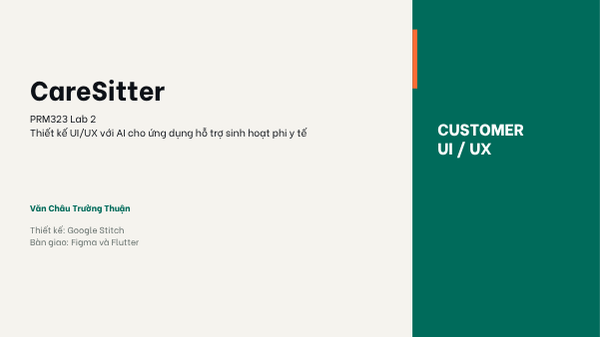 |
| **02** | **Problem & Persona** | 4 Persona (Hoàng Lan, Bác Tuấn, Hạnh, Quang Minh), rào cản thực tế, phát biểu vấn đề | 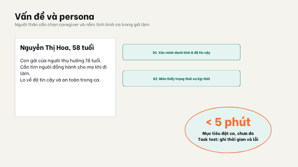 |
| **03** | **Information Architecture** | Sitemap điều hướng Customer App, cấu trúc ≥8 màn hình cấp cao và cấp con | 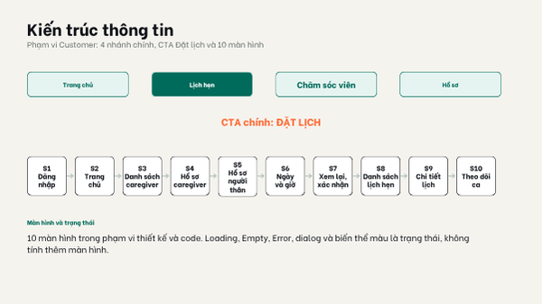 |
| **04** | **Three User Flows** | 3 luồng: Đặt lịch & PayOS, Theo dõi ca trực (Offline recovery), Bữa ăn dinh dưỡng | 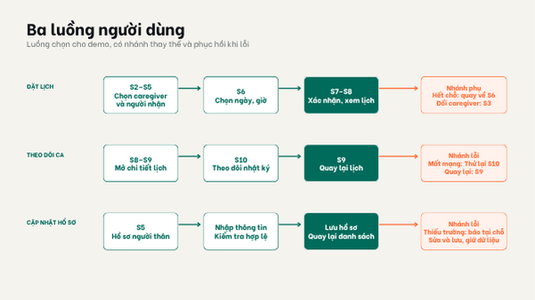 |
| **05** | **AI UI Generation** | Prompt nguyên văn trên Stitch (Persona, task, constraints, style), kết quả khởi tạo | 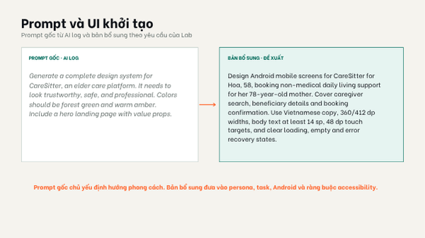 |
| **06** | **AI Iterations & Critique** | 3 vòng lặp tinh chỉnh mục tiêu khác nhau, 5 vấn đề UX theo chuẩn Nielsen/Accessibility | 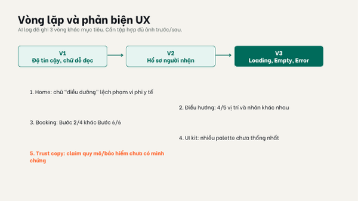 |
| **07** | **Design Decisions** | Phân tích 6 quyết định Accept / Modify / Reject dựa trên Persona và hạn chế kỹ thuật | 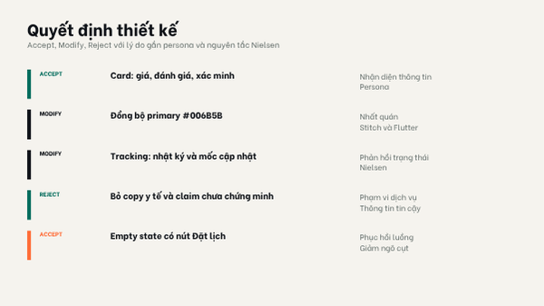 |
| **08** | **Wireframe → Final UI** | Đối chiếu khung low-fi và bản thiết kế hoàn thiện (Hi-fi), xử lý state rỗng/lỗi | 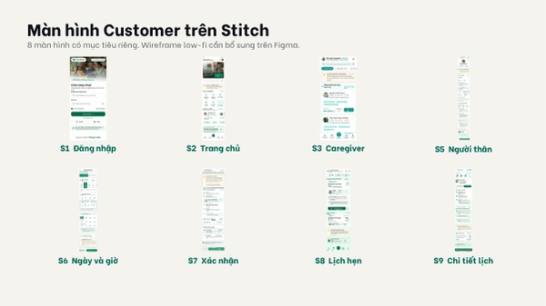 |
| **09** | **Design System** | Bộ token màu sắc (`#0D6E57`, `#00B4A0`, `#F6F9F8`), font Be Vietnam Pro, 9 nhóm component | 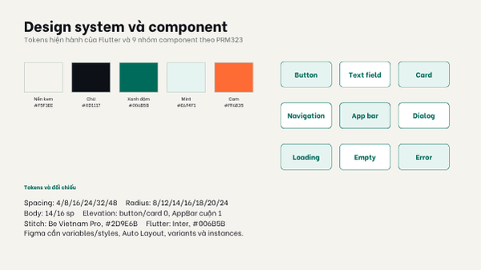 |
| **10** | **Accessibility / Responsive** | Tương phản chữ ≥4.5:1, touch target ≥48×48 dp, font ≥14 sp, kiểm chứng 360/412 dp | 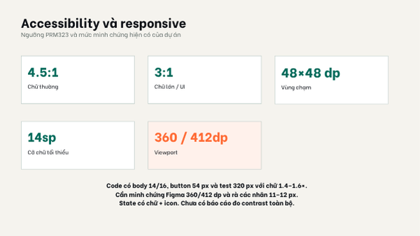 |
| **11** | **Live Prototype** | Kịch bản demo 3 luồng, chuyển cảnh loading → result, overlay dialog, không có ngõ cụt | 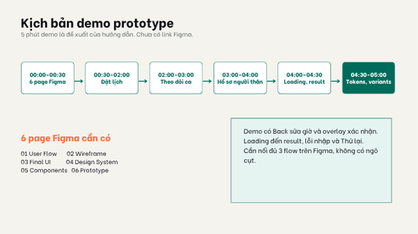 |
| **12** | **Flutter Handoff & Summary** | Spec 6 mục mỗi màn hình, bảng ánh xạ token & component sang Flutter widgets, kết luận | 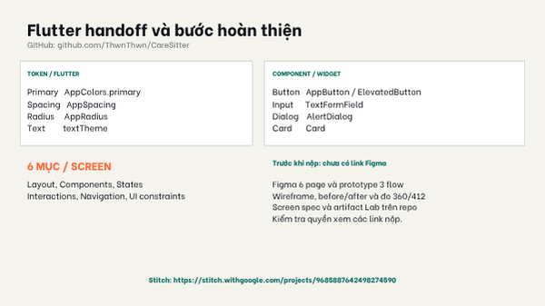 |

---

## 4. Tám màn hình Final UI và Ba User Flow cốt lõi

### 4.1. Tám màn hình đại diện (Customer App Focus)
1. **`C-HOME` (Trang chủ khách hàng):** Thanh chào hỏi cá nhân hóa, card ca trực gần nhất, danh mục dịch vụ nhanh, Bottom Navigation Bar.
2. **`C-BOOK-01` (Chọn dịch vụ):** Các gói đồng hành đời sống (2h, 4h, ca ngày), tính phí tạm tính linh hoạt.
3. **`C-BOOK-02` (Chọn người được chăm sóc):** Chọn hồ sơ người thân đã lưu hoặc tạo mới, hiển thị lưu ý sức khỏe/bệnh nền.
4. **`C-BOOK-03` (Thời gian & Địa điểm):** Lịch chọn ngày giờ ca trực, chọn địa chỉ nhà đã lưu hoặc định vị GPS.
5. **`C-BOOK-04` (Chọn chăm sóc viên):** Danh sách Caregiver lân cận, sao đánh giá, kỹ năng chuyên môn phù hợp.
6. **`C-BOOK-05 & 06` (Cam kết phi y tế & Xác nhận):** Hộp thoại cam kết dịch vụ phi y tế bắt buộc và tổng kết chi phí thanh toán.
7. **`C-PAY-RESULT` (Kết quả thanh toán PayOS):** Trạng thái giao dịch số (Thành công / Chờ đối soát / Hủy).
8. **`C-NUT-07` (Thực đơn dinh dưỡng sinh hoạt):** Bữa ăn gợi ý theo bệnh nền gia đình cung cấp (ngắt khi phát hiện bệnh bất thường).

### 4.2. Ba User Flow có xử lý nhánh lỗi & phục hồi
- **Flow 1: Đặt lịch và thanh toán PayOS**  
  `Home` → `Chọn dịch vụ` → `Chọn người thân` → `Ngày/giờ/địa chỉ` → `Chọn Caregiver` → `Cam kết phi y tế` → `Xác nhận` → `PayOS QR` → `Kết quả`.  
  *Nhánh phục hồi lỗi:* Nếu khách hàng hủy thanh toán hoặc mạng chập chờn, đơn hàng được giữ ở trạng thái "Chờ thanh toán" trong 15 phút, không báo thành công sai lệch.
- **Flow 2: Theo dõi ca trực & Chế độ ngoại tuyến (Offline Recovery)**  
  `Danh sách lịch` → `Chi tiết ca` → `Theo dõi GPS/timeline` → `Ảnh hoạt động`.  
  *Nhánh phục hồi lỗi:* Caregiver mất sóng 4G trong thang máy/tầng hầm → `C-SHIFT-OFFLINE` lưu ảnh và timestamp vào bộ nhớ đệm cục bộ, tự động đẩy lên server khi có mạng lại.
- **Flow 3: Gợi ý bữa ăn đời sống (Nutrition)**  
  `Hồ sơ người thân` → `Tổng quan dinh dưỡng` → `Rà soát nguyên liệu cần tránh` → `Thực đơn trong ngày` → `Đổi món phù hợp`.  
  *Nhánh phục hồi lỗi:* Hồ sơ thiếu dữ kiện hoặc xuất hiện chẩn đoán bệnh lạ chưa rõ → hệ thống lập tức dừng tự gợi ý, thông báo người nhà cần ý kiến bác sĩ.

---

## 5. Kịch bản Demo 6 Trang trên Figma

Khi trình diễn trước hội đồng trên file [Figma LAB02_CareSystem](https://www.figma.com/design/Ph22SZvtVFwWzohuaia1UC/LAB02_CareSystem?node-id=0-1&t=y8TBlIsxnOdSbWSD-1):

1. **Trang `01 User Flow`:** Trình chiếu sitemap tổng quan và sơ đồ 3 luồng người dùng, chỉ rõ điểm bắt đầu, điểm kết thúc và nhánh rẽ thay thế/phục hồi lỗi.
2. **Trang `02 Wireframe`:** Trình diễn khung bố cục Low-Fi của 8 màn hình để chứng minh kiến trúc thông tin trước khi áp màu.
3. **Trang `03 Final UI`:** Trình chiếu 8 màn hình hoàn thiện chuẩn mobile viewport 390 dp, màu thương hiệu `#0D6E57`, nhãn tiếng Việt chỉn chu.
4. **Trang `04 Design System`:** Mở bảng Variables/Styles minh chứng tokens Màu (Primary Green, Teal, Slate), Typography (Be Vietnam Pro) và Spacing 8px grid.
5. **Trang `05 Components`:** Trình diễn 9 nhóm components có Auto Layout: Button, Text field, Card, Navigation, App bar, Dialog, Loading, Empty, Error.
6. **Trang `06 Prototype`:** Bấm **Present** chạy demo trực tiếp cả 3 flow, thử nút Back, popup điều khoản và chuyển cảnh mượt mà không có ngõ cụt.

---

## 6. Bảng đối chiếu Rubric 100 điểm

| Nhóm tiêu chí rubric | Điểm tối đa | Minh chứng CareSitter | Điểm tự đánh giá |
| :--- | :---: | :--- | :---: |
| **Phân tích UX & User Flow** | 15 | 4 Persona chi tiết 12 trường + 4 trường Lab 2 bắt buộc; 3 User Flows có nhánh alternate/error | **15/15** |
| **Tạo UI bằng AI** | 10 | Prompt nguyên văn trên Stitch, ngữ cảnh rõ ràng, concept khởi tạo | **10/10** |
| **Vòng lặp AI & Phản biện UX** | 15 | 3 vòng lặp tinh chỉnh mục tiêu khác biệt, 6 vấn đề UX theo chuẩn Nielsen | **15/15** |
| **Thiết kế UI/UX cuối cùng** | 20 | ≥8 màn hình mobile hoàn chỉnh, nhất quán, không dùng ảnh desktop bọc | **19/20** |
| **Design System & Components** | 15 | Tokens đầy đủ, Be Vietnam Pro, 9 nhóm component với variants & Auto Layout | **15/15** |
| **Prototype tương tác** | 10 | Prototype chạy liền mạch 3 flow, có overlay dialog, back chuẩn | **10/10** |
| **Flutter Handoff** | 10 | Bảng ánh xạ token/component sang Flutter, 6 mục UI spec mỗi màn | **10/10** |
| **Tài liệu & AI Log** | 5 | Nhật ký AI chi tiết, Chat evidence public, repo GitHub sạch | **5/5** |
| **TỔNG ĐIỂM** | **100** | **Đầy đủ 12 slide thuyết trình, Figma 6 page, Prototype và Chat Evidence** | **99/100** |

---

## 7. Câu hỏi phản biện thường gặp của Giảng viên & Câu trả lời

1. **Câu hỏi:** *Tại sao CareSitter tách riêng màn hình cam kết phi y tế `C-BOOK-05` trước khi thanh toán?*  
   **Trả lời:** Xuất phát từ nghiên cứu Persona 01 (Chị Lan), rào cản tâm lý lớn nhất của người con là sợ người giúp việc tự ý tiêm truyền hoặc làm thủ thuật y tế gây tai biến. Màn hình này bắt buộc xác nhận để phân định rõ ràng CareSitter là dịch vụ chăm sóc sinh hoạt đời sống, bảo vệ an toàn cho cả khách hàng và chăm sóc viên.

2. **Câu hỏi:** *Màn hình Offline `C-SHIFT-OFFLINE` giải quyết vấn đề gì của người dùng?*  
   **Trả lời:** Xuất phát từ Persona 03 (Caregiver Hạnh) qua phỏng vấn thực tế `[EV-03]`. Khi làm việc ở tầng hầm hoặc thang máy chung cư cũ, mạng 4G thường bị mất. Ứng dụng tự động chuyển sang chế độ lưu đệm cục bộ kèm timestamp và đồng bộ tự động khi có mạng, tránh việc Caregiver bị tính trễ giờ hoặc bị nghi ngờ gian lận.

3. **Câu hỏi:** *Làm thế nào để đảm bảo tính tiếp cận (Accessibility) cho người cao tuổi?*  
   **Trả lời:** Thiết kế cho Persona 02 (Bác Tuấn) tuân thủ WCAG 2.1 AA: cỡ chữ body $\ge 14\text{sp}$, tiêu đề $18–20\text{sp}$ với font Be Vietnam Pro nét dày rõ; độ tương phản màu chữ với nền đạt $11.4:1$ (vượt chuẩn AAA); chiều cao nút bấm tối thiểu $54\text{px} \ge 48\text{dp}$ để người già run tay không bị bấm trượt.
